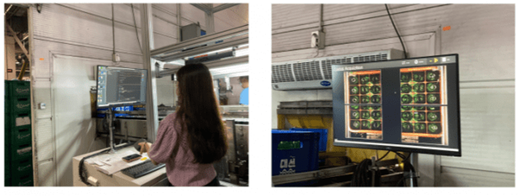
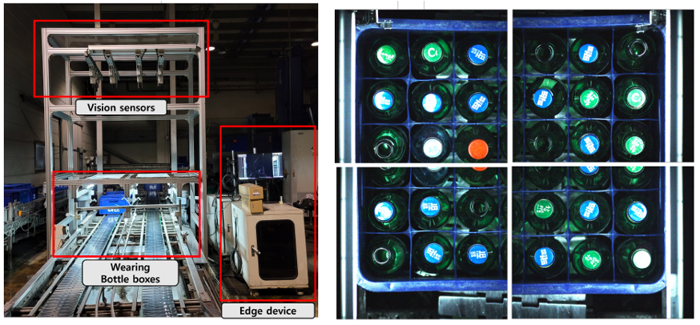

# YOLO Inference for Smart Brewing Factory

**Real-Time Vision Classification & Industrial MES Integration**

An industrial computer vision system developed by Yonsei University in collaboration with Daesun, a Korean brewing company.

The system performs **real-time classification of recyclable bottles** using YOLO-based object detection models, running directly on computing devices installed in the brewery's production environment.

Inference results are exported to Excel files for integration with the factory's **Manufacturing Execution System (MES)**.


---

## System Overview

The framework integrates image acquisition, YOLO inference, and industrial data management to support automated bottle classification in a real-world manufacturing environment.

**Key Features**
- **Real-Time Image Acquisition:** Collects and processes images from four devices deployed in the factory.
- **YOLO-Based Classification:** Detects and classifies recyclable bottles using trained object detection models.
- **Industrial Deployment:** Executes inference directly on computing equipment installed in the production environment.
- **MES Integration:** Exports classification results to Excel files for storage and integration with the factory's MES.

### Processing Pipeline

```text
Factory Imaging Devices (x4)
           │
           ▼
    Image Acquisition
           │
           ▼
     YOLO Inference
           │
           ▼
   Bottle Classification
           │
           ▼
    Excel Export
           │
           ▼
 Factory MES Integration
```

---

## Experimental Demonstration

Real-world deployment of the YOLO-based vision classification framework in the smart brewing factory.

<table>
  <tr>
    <td width="50%" align="center">
      
    </td>
    <td width="50%" align="center">
      
    </td>
  </tr>
</table>

---

## Repository Structure

```text
YOLO_inference/
├── README.md
├── img_acquisition_main.py
├── Yolo_inference.py
├── save_excel.py
└── assets/
    ├── exp1.png
    └── exp2.png
```

| File | Description |
|---|---|
| `img_acquisition_main.py` | Acquires and processes images from four factory devices. |
| `Yolo_inference.py` | Performs YOLO inference on the acquired images. |
| `save_excel.py` | Exports inference results to Excel files for MES integration. |

---

## Model Training

The model training implementation is maintained in a separate repository.

[](https://github.com/NamHyelin/Yolov4_split_learning)

---

## Publication

**Demo: ML-based Vision Classification in the Smart Brewing Factory Testbed**

S. Kook, S. Baek, **H. Nam**, and S.-L. Kim

*IEEE International Conference on Communications Workshops (ICC Workshops), 2022.*

[](https://doi.org/10.1109/ICCWorkshops53468.2022.9915030)
[](https://scholar.google.com/scholar?q=Demo%3A+ML-based+Vision+Classification+in+the+Smart+Brewing+Factory+Testbed)
